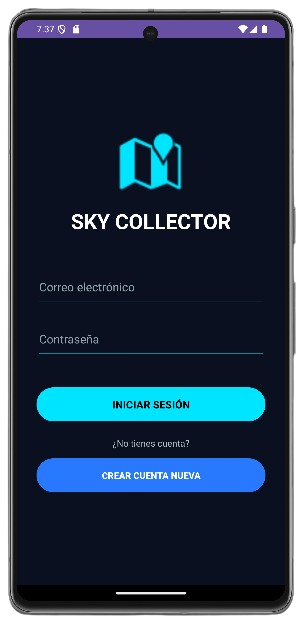
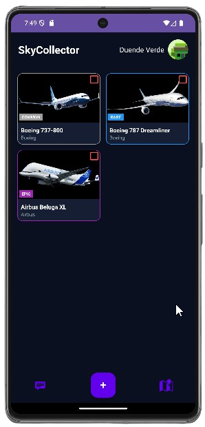
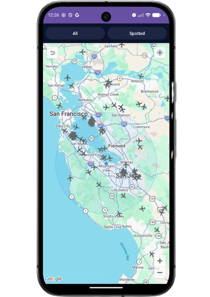
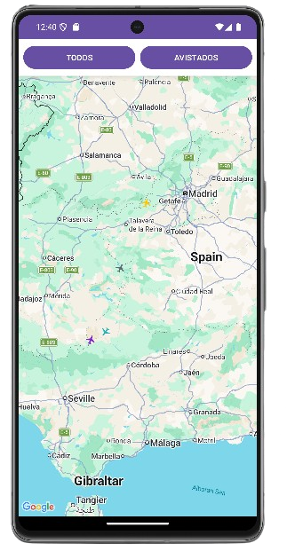
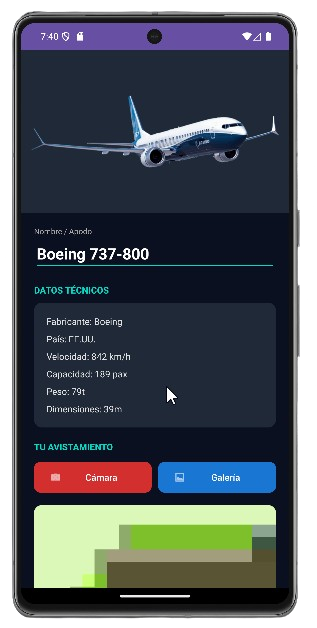
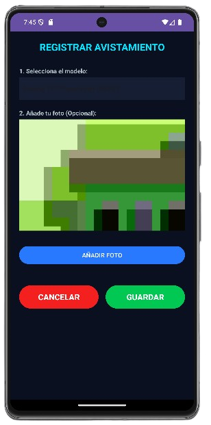
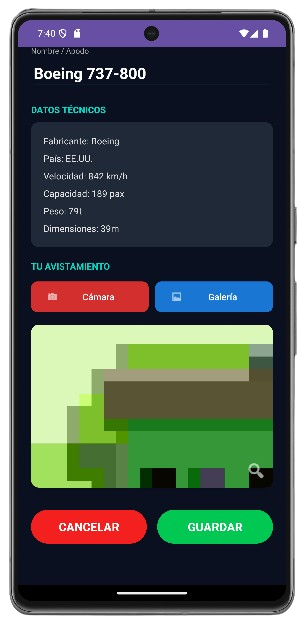
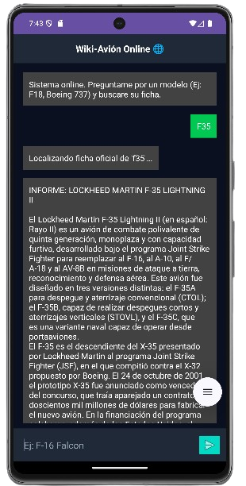
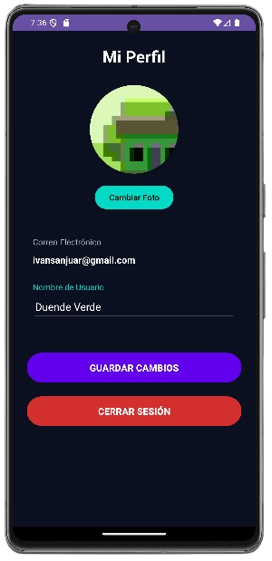

# ✈️ SkyCollectorApp


**SkyCollectorApp** es una aplicación nativa para Android que convierte el tráfico aéreo real en un juego de colección (*plane spotting*). Permite visualizar vuelos en directo sobre un mapa interactivo, capturar aeronaves cercanas mediante la cámara del dispositivo, clasificarlas según su rareza y competir en un ranking global sincronizado en la nube.

---

## 📱 Características principales

* **Radar en directo:** Mapa interactivo con los vuelos activos en la zona visible, desplazamiento suave interpolado y estela del recorrido de la aeronave seleccionada.
* **Captura por proximidad:** Avistamiento de aviones dentro de un radio máximo de **40 km** mediante verificación GPS y fotografía tomada en el momento.
* **Hangar personal:** Colección agrupada por modelo con contador de unidades, matrícula, fecha, distancia de captura y fotografía verificada.
* **Sistema de rareza y puntuación:** Clasificación automática de ~280 modelos comerciales, privados, militares e históricos.
* **Ranking global y perfiles públicos:** Clasificación en tiempo real del Top 50 de pilotos y consulta de hangares de otros usuarios.
* **Ficha técnica enriquecida:** Identificación automática de modelo, aerolínea, ruta comercial, telemetría y descripción enciclopédica.
* **Chatbot aeronáutico:** Asistente conversacional capaz de identificar modelos y resumir sus características técnicas.
* **Multi-idioma y temas:** Soporte completo para **Español e Inglés**, con adaptación a **tema claro y oscuro**.

---

## 🧩 Funcionalidades en detalle

### 🗺️ Mapa y radar en tiempo real
* Descarga de vuelos en un radio de hasta **250 millas náuticas** con refresco automático cada **15 segundos**.
* Interpolación de movimiento entre actualizaciones calculada a partir de la velocidad terrestre y el rumbo (*track*).
* Control de *rate-limiting* (tiempos de espera y bloqueo de peticiones concurrentes) para evitar saturar las APIs públicas.
* Filtro rápido entre **todos los vuelos activos** y **aviones ya avistados**, diferenciando los iconos en el mapa según su rareza.

### 🎯 Reglas de avistamiento
1. **Proximidad GPS:** El dispositivo debe encontrarse a **$\le$ 40 km** de la aeronave.
2. **Unicidad:** Cada avión físico (identificado por su código hexadecimal ICAO de 24 bits) solo puede registrarse una vez por usuario.
3. **Verificación automática:** El modelo se asigna directamente desde la telemetría del radar y el motor de identificación; no es editable manualmente.
4. **Fotografía en directo:** La captura se realiza exclusivamente desde la cámara de la app (sin acceso a galería) y se comprime antes de subirla a la nube.

### 🧰 Catálogo y sistema de rarezas

La aplicación incluye una base de datos local con **~280 modelos** (aviación comercial, regional, ejecutiva, ligera, helicópteros, transporte y aeronaves históricas en activo). Los modelos sin fotografía real disponen de siluetas vectoriales específicas por categoría.

| Rareza | Puntos | Ejemplos de aeronaves |
| :--- | :---: | :--- |
| ⚪ **COMMON** (Común) | **10** | Airbus A320, Boeing 737, Cessna 172 |
| 🔵 **RARE** (Raro) | **25** | Boeing 787, Airbus A330, jets privados, turbohélices regionales |
| 🟣 **EPIC** (Épico) | **50** | Airbus A380, Boeing 747, cargueros pesados y cazas modernos |
| 🟡 **LEGENDARY** (Legendario) | **100** | Douglas DC-3, Supermarine Spitfire, P-51 Mustang |
| 🔴 **MYTHIC** (Mítico) | **200** | *Reservada en el motor de puntuación para eventos especiales* |

---

## 🧠 Motor híbrido de identificación (`AvionGenerator`)

Para evitar entradas genéricas (*"Unknown Aircraft"*) cuando un transpondedor no emite el tipo de aeronave, la aplicación ejecuta un **pipeline de resolución en cascada** con caché de doble capa:

```text
[ Radar ADS-B ] ──▶ ¿Trae tipo ICAO? ──(SÍ)──▶ [ Catálogo Local (~280 modelos) ]
                          │                                   │
                         (NO)                           (No catalogado)
                          ▼                                   ▼
         [ HexDB → ADSBDB → OpenSky ] ─────────▶ [ Wikipedia API (ES / EN) ]
         (Búsqueda por Hex y Matrícula)              (Ficha e imagen remota)
```

* **Caché inteligente:** Los aciertos se persisten en disco (`SharedPreferences`) para ahorrar datos y llamadas de red, mientras que los fallos se almacenan únicamente en memoria RAM para permitir reintentos futuros sin invalidaciones manuales.
* **Easter Eggs de aeropuerto:** Detección automática de balizas terrestres que emiten en frecuencias ADS-B, como vehículos de asistencia en pista (`GRND`, `SERV`, `GND`) y torres de control (`TWR`).

---

## 🌍 Fuentes de datos

| Servicio | Función en la aplicación |
| :--- | :--- |
| **adsb.lol** | Posición geográfica, altitud, velocidad y rumbo en tiempo real (datos ADS-B abiertos) |
| **ADSBDB** | Resolución de modelo exacto, aerolínea y ruta comercial por ICAO Hex o matrícula (*N-Number*) |
| **HexDB & OpenSky Network** | Respaldo secundario para identificación de aeronaves recientes mediante código Modo S |
| **MediaWiki / Wikipedia** | Descripciones técnicas, fotografías de modelos y base de conocimiento del chatbot (CC BY-SA 4.0) |
| **Google Maps SDK** | Renderizado del mapa, marcadores personalizados y geolocalización del usuario |
| **Firebase** | Autenticación multicanal (Email, Google, SMS), base de datos Firestore y analíticas |

---

## 🛠️ Stack tecnológico

* **Lenguaje:** Java 8
* **SDK & Build:** Android SDK (`minSdk 24`, `targetSdk 34`), Gradle con AGP 8.2.0 y ViewBinding
* **Interfaz de usuario:** XML, Material Design, `ConstraintLayout`, `RecyclerView`, `PhotoView`
* **Red y serialización:** Retrofit 2, Gson, Volley y `HttpURLConnection`
* **Gestión de imágenes:** Glide, Coil y compresión Base64 personalizada
* **Backend as a Service:** Firebase Authentication, Cloud Firestore y Analytics (BoM 32.7.1)

---

## 🏗️ Arquitectura del proyecto

```text
app/
├── manifests/
│   └── AndroidManifest.xml
│
├── java/es.medac.skycollectorapp/
│   ├── activities/
│   │   ├── LoginActivity.java              # Autenticación (Correo, Google y SMS)
│   │   ├── MainActivity.java               # Hangar personal agrupado por modelo
│   │   ├── MapaActivity.java               # Radar en directo y control de avistamientos
│   │   ├── DetalleVueloRadarActivity.java  # Ficha previa de vuelo y telemetría en vivo
│   │   ├── AddAvionActivity.java           # Captura fotográfica y registro en la nube
│   │   ├── DetalleAvionActivity.java       # Vista detallada de un avión coleccionado
│   │   ├── RankingActivity.java            # Clasificación global Top 50
│   │   ├── PerfilPublicoActivity.java      # Estadísticas y colección de otros pilotos
│   │   ├── PerfilActivity.java             # Gestión de cuenta y preferencias
│   │   └── ChatbotActivity.java            # Asistente conversacional de aeronaves
│   │
│   ├── adapters/                           # AvionAdapter, ChatAdapter, RankingAdapter...
│   │
│   ├── models/
│   │   ├── Avion.java                      # Entidad principal de avistamiento
│   │   ├── GrupoAvion.java                 # Agrupación por modelo en el hangar
│   │   ├── Vuelo.java                      # Objeto de telemetría del radar
│   │   ├── AdsbResponse.java               # Mapeo JSON de adsb.lol
│   │   ├── AdsbdbResponse.java             # Mapeo JSON de adsbdb
│   │   └── Mensaje.java                    # Modelo de mensajes del chatbot
│   │
│   ├── network/
│   │   ├── AdsbService.java                # Interfaz Retrofit de tráfico aéreo
│   │   └── AdsbdbService.java              # Interfaz Retrofit de metadatos y rutas
│   │
│   └── utils/
│       ├── AvionGenerator.java             # Catálogo maestro y motor híbrido
│       ├── RankingManager.java             # Cálculo de puntos y sincronización en Firestore
│       └── ImagenBase64Utils.java          # Compresión y codificación de fotografías
│
├── res/
│   ├── layout/ drawable/ menu/ mipmap/ xml/
│   └── values/ values-en/ values-night/    # Internacionalización y modo oscuro
│
├── Documentacion/                          # Memoria técnica y documentación del proyecto
└── capturas/                               # Recursos visuales de la aplicación
```

---

## ☁️ Estructura en Cloud Firestore

| Ruta del documento | Descripción |
| :--- | :--- |
| `usuarios/{uid}` | Datos privados de configuración del perfil del usuario |
| `usuarios/{uid}/aviones/{id}` | Colección privada con cada avistamiento, coordenadas y fotografía |
| `ranking/{uid}` | Perfil público con nombre, avatar, puntuación total y contador de verificados |

### Reglas de seguridad recomendadas

```javascript
rules_version = '2';
service cloud.firestore {
  match /databases/{database}/documents {

    // Datos privados: acceso exclusivo para el propietario
    match /usuarios/{uid} {
      allow read, write: if request.auth != null && request.auth.uid == uid;
      match /{document=**} {
        allow read, write: if request.auth != null && request.auth.uid == uid;
      }
    }

    // Ranking público: lectura para usuarios autenticados; escritura solo en el propio perfil
    match /ranking/{uid} {
      allow read: if request.auth != null;
      allow create, update: if request.auth != null && request.auth.uid == uid;
      allow delete: if false;
    }

    match /{document=**} {
      allow read, write: if false;
    }
  }
}
```

> **Nota de arquitectura:** Para blindar el sistema de puntuación frente a manipulaciones en cliente en un entorno de producción, el cálculo de puntos debería delegarse a **Firebase Cloud Functions**.

---

## 🖼️ Capturas de pantalla

| Inicio de sesión | Colección (Hangar) | Radar en directo |
| :---: | :---: | :---: |
|  |  |  |

| Filtro de avistados | Detalle de aeronave | Registro con cámara |
| :---: | :---: | :---: |
|  |  |  |

| Ficha técnica | Chatbot | Perfil de usuario |
| :---: | :---: | :---: |
|  |  |  |

---

## ▶️ Instalación y configuración

### Requisitos previos
* **Android Studio** (versión Iguana o superior) con **JDK 17**.
* Dispositivo físico o emulador con **Android 7.0 (API 24)** o superior.
* Cuenta de Google con acceso a **Firebase Console** y **Google Cloud Platform**.

### Pasos de despliegue

1. **Clonar el repositorio:**
   ```bash
   git clone [https://github.com/Ivannovichh/SkyCollectorApp.git](https://github.com/Ivannovichh/SkyCollectorApp.git)
   ```
2. **Configurar Firebase:**
   * Crea un proyecto en Firebase y registra una app Android con el paquete `es.medac.skycollectorapp`.
   * Descarga el archivo `google-services.json` y ubícalo dentro de la carpeta `app/`.
   * Habilita **Cloud Firestore** y los proveedores de **Authentication** (Correo/Contraseña, Google y Teléfono).
3. **Registrar huellas SHA-1 y SHA-256:**
   * Obtén las huellas de tu entorno ejecutando `./gradlew signingReport` y añádelas en la configuración de tu app en Firebase (imprescindibles para Google Sign-In y autenticación por SMS).
4. **Configurar Google Maps API Key:**
   * Habilita **Maps SDK for Android** en Google Cloud, genera una clave de API y añádela en `app/src/main/AndroidManifest.xml` dentro de `com.google.android.geo.API_KEY`.
   * *Recomendación:* Restringe la clave por nombre de paquete y huella SHA-1 antes de publicar cambios.
5. **Compilar y ejecutar:**
   * Sincroniza Gradle en Android Studio y ejecuta la aplicación otorgando permisos de ubicación y cámara.

---

## 🔐 Permisos requeridos

| Permiso | Finalidad |
| :--- | :--- |
| `INTERNET` / `ACCESS_NETWORK_STATE` | Consulta de APIs de tráfico aéreo, Wikipedia y sincronización con Firebase |
| `ACCESS_FINE_LOCATION` / `COARSE` | Posicionamiento en el mapa y verificación del radio de 30 km para avistar |
| `CAMERA` | Captura fotográfica verificada de aeronaves y actualización de foto de perfil |

---

## 🚀 Hoja de ruta (Próximos pasos)

* [ ] Seguimiento personalizado de matrículas específicas (*Watchlist* / alertas de proximidad).
* [ ] Modo de avistamientos especiales para aeronaves estáticas en museos o exhibiciones sin transpondedor activo.
* [ ] Validación de puntuaciones en servidor mediante Cloud Functions.
* [ ] Ampliación dinámica del catálogo de aeronaves desde Firestore sin necesidad de actualizar la APK.

---

## 👨‍💻 Autores

* **Iván Sánchez**
* **Ángel Japón**

---

## ⚖️ Licencia y aviso legal

Distribuido bajo la licencia **MIT**. Consulta el archivo `LICENSE` para más información.

* Los datos de tráfico aéreo proceden de redes colaborativas ADS-B abiertas y pueden presentar latencia o datos incompletos; **no deben utilizarse para navegación aérea ni fines operativos**.
* Los textos enciclopédicos proceden de Wikipedia bajo licencia **CC BY-SA 4.0**.
