# ✈️ SkyCollectorApp


**SkyCollectorApp** is a native Android application that turns real-time air traffic into a gamified collection game (*plane spotting*). It allows users to view live flights on an interactive map, capture nearby aircraft using the device's camera, classify them by rarity, and compete on a cloud-synchronized global leaderboard.

---

## 📱 Main Features

- **Live Radar:** Interactive map featuring active flights in the visible area, smooth interpolated movement, and flight trails for selected aircraft.
- **Proximity Capture:** Spot aircraft within a maximum radius of **40 km** using GPS verification and a real-time photograph.
- **Personal Hangar:** Collection grouped by model with unit counts, registration numbers, capture dates, distances, and verified photos.
- **Rarity & Scoring System:** Automatic classification of ~280 commercial, private, military, and historical models.
- **Global Leaderboard & Public Profiles:** Real-time Top 50 pilot rankings and inspection of other users' hangars.
- **Enriched Technical Sheet:** Automatic identification of models, airlines, commercial routes, telemetry, and encyclopedic descriptions.
- **Aeronautical Chatbot:** Conversational assistant capable of identifying models and summarizing their technical specs.
- **Multi-language & Themes:** Full support for **Spanish and English**, complete with **light and dark theme** adaptation.

---

## 🧩 Detailed Features

### 🗺️ Real-Time Map & Radar
- Download flights within a radius of up to **250 nautical miles** with automatic refreshing every **15 seconds**.
- Movement interpolation between updates calculated using ground speed and track angle.
- Rate-limiting control (cooldowns and concurrent request blocking) to prevent public API throttling.
- Quick filtering between **all active flights** and **already spotted aircraft**, with map icons styled according to rarity.

### 🎯 Spotting Rules
1. **GPS Proximity:** The device must be located **$\le$ 40 km** from the aircraft.
2. **Uniqueness:** Each physical aircraft (identified by its 24-bit ICAO hex code) can only be registered once per user.
3. **Automatic Verification:** The model is assigned directly from radar telemetry and the identification engine; it is not manually editable.
4. **Live Photography:** Captures are taken exclusively through the app's camera (no gallery access) and compressed before cloud upload.

### 🧰 Catalog & Rarity System

The application includes a local database with **~280 models** (commercial, regional, executive, light aviation, helicopters, cargo, and active historical aircraft). Models without a real photograph feature category-specific vector silhouettes.

| Rarity | Points | Example Aircraft |
| :--- | :---: | :--- |
| ⚪ **COMMON** | **10** | Airbus A320, Boeing 737, Cessna 172 |
| 🔵 **RARE** | **25** | Boeing 787, Airbus A330, private jets, regional turboprops |
| 🟣 **EPIC** | **50** | Airbus A380, Boeing 747, heavy cargo, modern fighters |
| 🟡 **LEGENDARY** | **100** | Douglas DC-3, Supermarine Spitfire, P-51 Mustang |
| 🔴 **MYTHIC** | **200** | *Reserved in the scoring engine for special events* |

---

## 🧠 Hybrid Identification Engine (`AvionGenerator`)

To prevent generic entries (*"Unknown Aircraft"*) when a transponder does not broadcast the aircraft type, the app executes a **cascading resolution pipeline** with a double-layer cache:

```text
[ ADS-B Radar ] ──▶ Has ICAO type? ──(YES)──▶ [ Local Catalog (~280 models) ]
                      │                                   │
                     (NO)                              (Not cataloged)
                      ▼                                   ▼
         [ HexDB → ADSBDB → OpenSky ] ─────────▶ [ Wikipedia API (ES / EN) ]
         (Hex & Registration Lookup)               (Remote sheet & image)
```

- **Smart Cache:** Hits are persisted on disk (`SharedPreferences`) to save data and network calls, while misses are stored solely in RAM to allow future retries without manual invalidation.
- **Airport Easter Eggs:** Automatic detection of ground beacons broadcasting on ADS-B frequencies, such as ground service vehicles (`GRND`, `SERV`, `GND`) and control towers (`TWR`).

---

## 🌍 Data Sources

| Service | Application Function |
| :--- | :--- |
| **adsb.lol** | Real-time geographic position, altitude, speed, and track (open ADS-B data) |
| **ADSBDB** | Exact model resolution, airline, and commercial route via ICAO Hex or registration (*N-Number*) |
| **HexDB & OpenSky Network** | Secondary backup for identifying recent aircraft via Mode S code |
| **MediaWiki / Wikipedia** | Technical descriptions, model photographs, and chatbot knowledge base (CC BY-SA 4.0) |
| **Google Maps SDK** | Map rendering, custom markers, and user geolocation |
| **Firebase** | Multi-channel authentication (Email, Google, SMS), Cloud Firestore database, and analytics |

---

## 🛠️ Tech Stack

- **Language:** Java 8
- **SDK & Build:** Android SDK (`minSdk 24`, `targetSdk 34`), Gradle with AGP 8.2.0 and ViewBinding
- **User Interface:** XML, Material Design, `ConstraintLayout`, `RecyclerView`, `PhotoView`
- **Network & Serialization:** Retrofit 2, Gson, Volley, and `HttpURLConnection`
- **Image Management:** Glide, Coil, and custom Base64 compression
- **Backend as a Service:** Firebase Authentication, Cloud Firestore, and Analytics (BoM 32.7.1)

---

## 🏗️ Project Architecture

```text
app/
├── manifests/
│   └── AndroidManifest.xml
│
├── java/es.medac.skycollectorapp/
│   ├── activities/
│   │   ├── LoginActivity.java              # Authentication (Email, Google, and SMS)
│   │   ├── MainActivity.java               # Personal hangar grouped by model
│   │   ├── MapaActivity.java               # Live radar and sighting control
│   │   ├── DetalleVueloRadarActivity.java  # Preliminary flight sheet & live telemetry
│   │   ├── AddAvionActivity.java           # Photo capture and cloud registration
│   │   ├── DetalleAvionActivity.java       # Detailed view of a collected aircraft
│   │   ├── RankingActivity.java            # Global Top 50 leaderboard
│   │   ├── PerfilPublicoActivity.java      # Statistics and collections of other pilots
│   │   ├── PerfilActivity.java             # Account management and preferences
│   │   └── ChatbotActivity.java            # Conversational aircraft assistant
│   │
│   ├── adapters/                           # AvionAdapter, ChatAdapter, RankingAdapter...
│   │
│   ├── models/
│   │   ├── Avion.java                      # Main sighting entity
│   │   ├── GrupoAvion.java                 # Model grouping in the hangar
│   │   ├── Vuelo.java                      # Radar telemetry object
│   │   ├── AdsbResponse.java               # adsb.lol JSON mapping
│   │   ├── AdsbdbResponse.java             # adsbdb JSON mapping
│   │   └── Mensaje.java                    # Chatbot message model
│   │
│   ├── network/
│   │   ├── AdsbService.java                # Retrofit interface for air traffic
│   │   └── AdsbdbService.java              # Retrofit interface for metadata and routes
│   │
│   └── utils/
│       ├── AvionGenerator.java             # Master catalog & hybrid engine
│       ├── RankingManager.java             # Point calculation and Firestore sync
│       └── ImagenBase64Utils.java          # Photo compression and encoding
│
├── res/
│   ├── layout/ drawable/ menu/ mipmap/ xml/
│   └── values/ values-en/ values-night/    # Internationalization and dark mode
│
├── Documentacion/                          # Technical memory and project documentation
└── capturas/                               # Visual assets of the application
```

---

## ☁️ Cloud Firestore Structure

| Document Path | Description |
| :--- | :--- |
| `usuarios/{uid}` | Private user profile configuration data |
| `usuarios/{uid}/aviones/{id}` | Private collection containing each sighting, coordinates, and photo |
| `ranking/{uid}` | Public profile containing name, avatar, total score, and verified count |

### Recommended Security Rules

```javascript
rules_version = '2';
service cloud.firestore {
  match /databases/{database}/documents {

    // Private data: exclusive access for the owner
    match /usuarios/{uid} {
      allow read, write: if request.auth != null && request.auth.uid == uid;
      match /{document=**} {
        allow read, write: if request.auth != null && request.auth.uid == uid;
      }
    }

    // Public leaderboard: readable for authenticated users; writable only on own profile
    match /ranking/{uid} {
      allow read: if request.auth != null;
      allow create, update: if request.auth != null && request.auth.uid == uid;
      allow delete: if false;
    }

    match /{document=**} {
      allow read, write: if false;
    }
  }
}
```

> **Architectural Note:** To protect the scoring system against client-side tampering in a production environment, point calculations should be delegated to **Firebase Cloud Functions**.

---
## 🖼️ Screenshots

### 👤 User
| Login | User Configuration | User Profile |
| :---: | :---: | :---: |
| 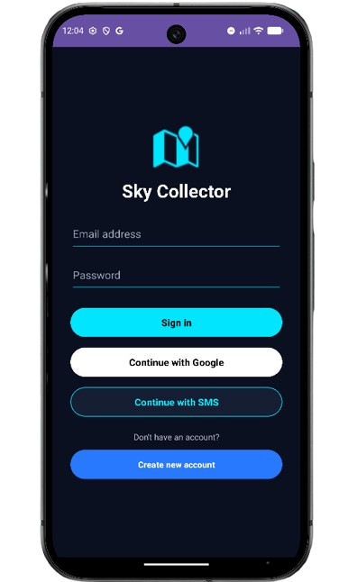 | 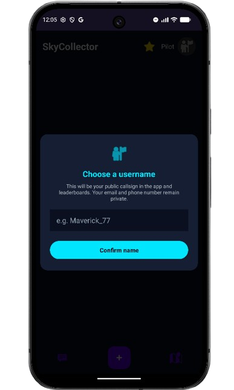 | 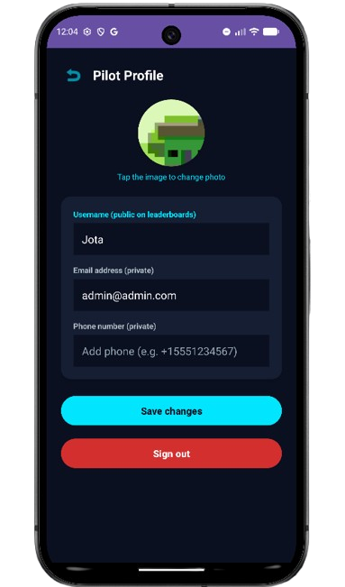 |

### 🛩️ Collection
| Collection (Hangar) | Collection with Added Photo | Duplicate Collection |
| :---: | :---: | :---: |
| 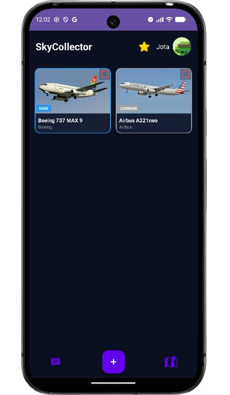 | 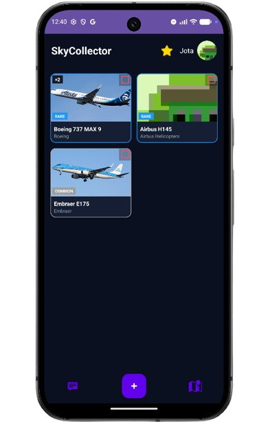 | 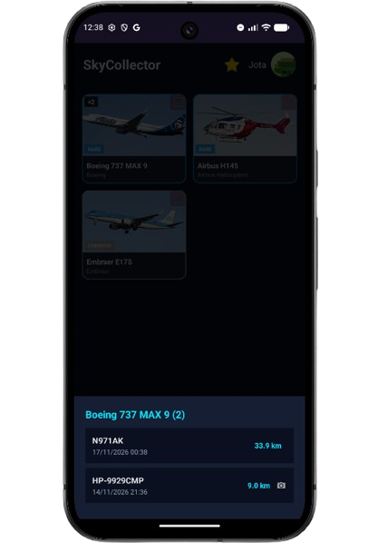 |

| Basic Sighting | Sighting with Photo | Sighting Process |
| :---: | :---: | :---: |
| 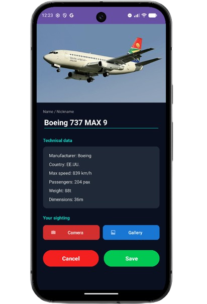 | 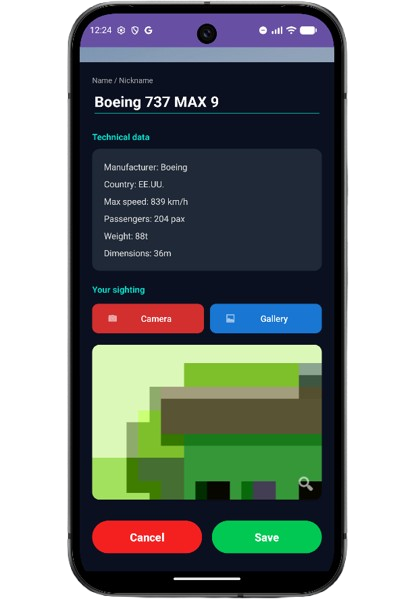 | 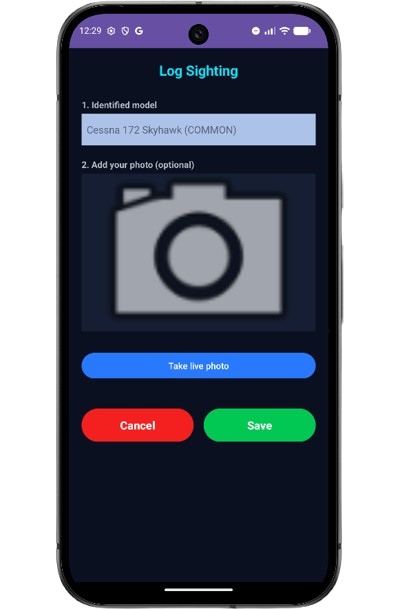 |

| Aircraft Deletion | Duplicate Deletion |
| :---: | :---: |
| 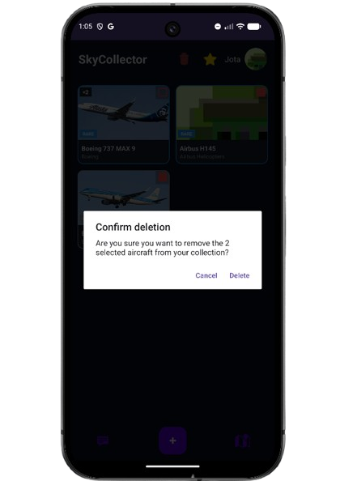 | 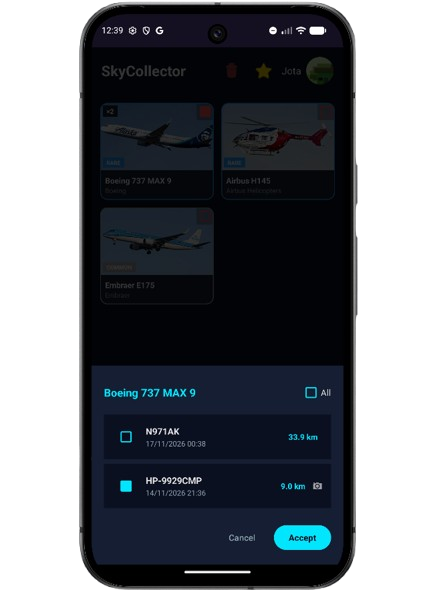 |

### 🗺️ Map
| Live Radar | Spotted Map | Radar with Alert | Alert Technical Sheet |
| :---: | :---: | :---: | :---: |
|  | 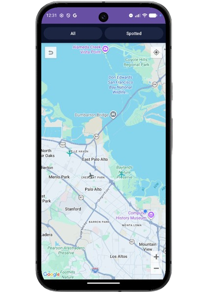 | 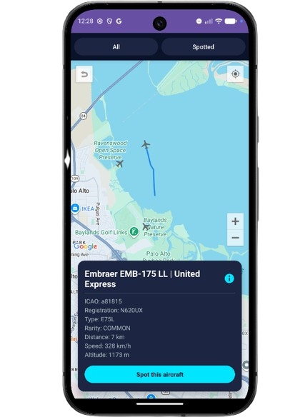 | 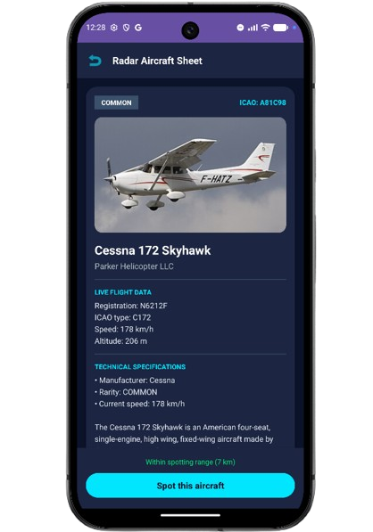 |

### 🏆 Leaderboard
| Leaderboard Table | Pilot Hangar in Leaderboard | Leaderboard Technical Sheet |
| :---: | :---: | :---: |
| 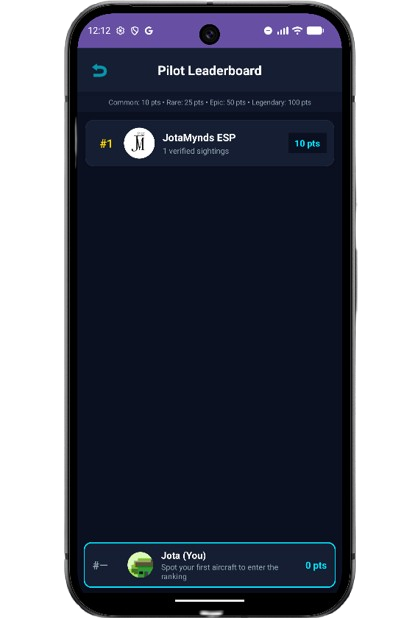 | 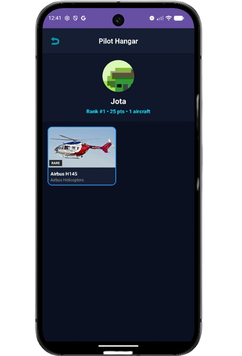 | 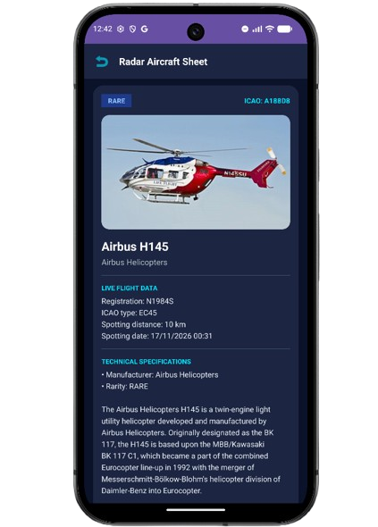 |

### 🤖 Chatbot
| Assistant Chatbot | Offline Chatbot |
| :---: | :---: |
| 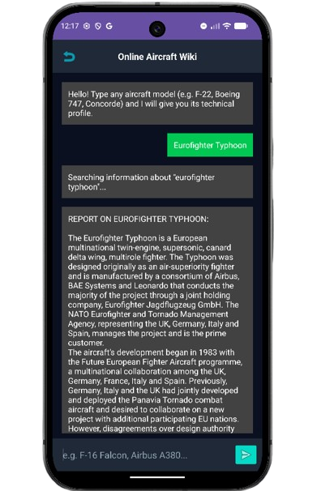 | 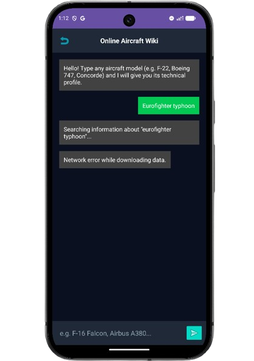 |

---

## ▶️ Installation & Setup

### Prerequisites
- **Android Studio** (Iguana version or higher) with **JDK 17**.
- Physical device or emulator running **Android 7.0 (API 24)** or higher.
- Google account with access to **Firebase Console** and **Google Cloud Platform**.

### Deployment Steps

1. **Clone the repository:**
   ```bash
   git clone https://github.com/Ivannovichh/SkyCollectorApp.git
   ```
2. **Configure Firebase:**
   * Create a Firebase project and register an Android app with the package name `es.medac.skycollectorapp`.
   * Download the `google-services.json` file and place it inside the `app/` folder.
   * Enable **Cloud Firestore** and **Authentication** providers (Email/Password, Google, and Phone).
3. **Register SHA-1 and SHA-256 Fingerprints:**
   * Obtain your environment fingerprints by running `./gradlew signingReport` and add them to your Firebase app configuration (essential for Google Sign-In and SMS authentication).
4. **Configure Google Maps API Key:**
   * Enable **Maps SDK for Android** in Google Cloud, generate an API key, and add it in `app/src/main/AndroidManifest.xml` under `com.google.android.geo.API_KEY`.
   * *Recommendation:* Restrict the key by package name and SHA-1 fingerprint before publishing changes.
5. **Build and Run:**
   * Sync Gradle in Android Studio and run the application by granting location and camera permissions.

---

## 🔐 Required Permissions

| Permission | Purpose |
| :--- | :--- |
| `INTERNET` / `ACCESS_NETWORK_STATE` | Querying air traffic APIs, Wikipedia, and Firebase synchronization |
| `ACCESS_FINE_LOCATION` / `COARSE` | Map positioning and checking the 40 km spotting radius |
| `CAMERA` | Verified photographic capture of aircraft and profile picture updates |

---

## 🚀 Roadmap

- [ ] Custom tracking of specific registrations (*Watchlist* / proximity alerts).
- [ ] Special spotting mode for static aircraft in museums or exhibitions without an active transponder.
- [ ] Server-side score validation using Cloud Functions.
- [ ] Dynamic expansion of the aircraft catalog from Firestore without requiring an APK update.

---

## 👨‍💻 Authors

- **Iván Sánchez**
- **Ángel Japón**

---

## ⚖️ License & Legal Disclaimer

Distributed under the **MIT** license. See the `LICENSE` file for more information.

- Air traffic data comes from open collaborative ADS-B networks and may present latency or incomplete data; **it must not be used for air navigation or operational purposes**.
- Encyclopedic texts come from Wikipedia under the **CC BY-SA 4.0** license.
